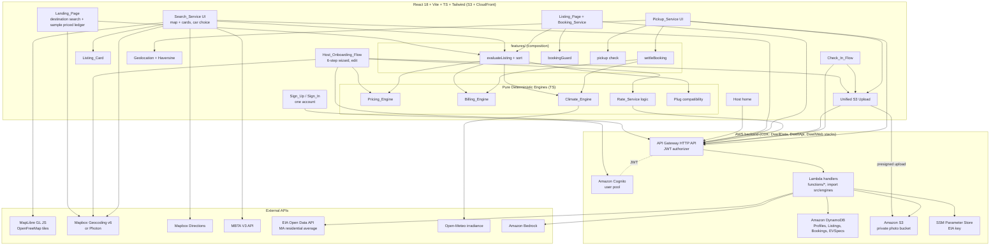

# Design Document

## Overview

Dwell is a peer-to-peer "charge-and-ride" marketplace for Massachusetts EV drivers. Hosts list idle residential L1/L2 chargers and driveways; Customers book a time window, park, plug in without a key handoff, charge, and continue by MBTA transit or on foot. Because Hosts have no smart meters, the economic safety of the platform rests on a single guarantee: the hourly price is **deterministic and formula-driven**, mathematically bounded to always cover the maximum possible electricity draw of the specific car booked — both during the reservation and during any overstay.

This design realizes the six requirements through a thin, reactive React frontend over a plain AWS backend defined with AWS CDK (Cognito, API Gateway HTTP API, Lambda, DynamoDB, S3, CloudFront; no Amplify), with all money- and climate-affecting logic factored into **pure, deterministic TypeScript engines** (`Pricing_Engine`, `Billing_Engine`, `Climate_Engine`, `Rate_Service`). Keeping these engines free of I/O and framework state is a deliberate design decision: it makes the two PBT invariants in the requirements (Host Cost Upper-Bound, Green Score Bounds) directly unit- and property-testable, and it isolates external-API variability (EIA, Mapbox, MBTA, Open-Meteo, Bedrock) behind adapter boundaries.

Key design decisions and rationale:

- **Formula-only pricing; AI only for data lookup.** Amazon Bedrock is invoked *solely* to look up `car_max_AC_kW` for a vehicle absent from the EVSpec table (Requirement 1.9). It never influences a price. This keeps the Host Cost Upper-Bound Invariant (Property 1) provable, because pricing depends only on numeric inputs with known bounds.
- **Worst-case defaulting.** When `car_max_AC_kW` cannot be determined, the system defaults it to the Host's `charger_kW` (Requirement 1.10), forcing `P_eff = min(charger_kW, car_max_AC_kW) = charger_kW` — the maximum possible draw — so the Host never under-charges.
- **Pure engines, impure adapters.** Engines accept plain numeric inputs and return plain values or typed errors; adapters own timeouts, retries, and fallbacks (Requirements 1.6/1.7, 2.4, 4.2, 5.2/5.4).
- **Unified S3 upload flow.** Listing, Arrival, and Pickup photos share one upload component and one error/retry contract (Requirement 1.4, 5.2), differing only by S3 key.
- **One account, no roles.** A single account can book chargers and list one charger (Requirement 1.12). The car is chosen where prices are shown (Search, listing page), not at sign-up (Requirement 1.8).

### Current prototype

The UI and workflow run today as a browser prototype: React Router pages over a `localStorage` state provider, sample listings, a prototype sign-in, and the real engines. The backend pieces in this document (CDK stacks, Cognito, the HTTP API and Lambdas, DynamoDB, S3, CloudFront, MBTA, Open-Meteo, Mapbox Directions, Bedrock) are not built yet. The prototype keeps the same seams so each one can be swapped in:

| Seam | Prototype today | Target |
|---|---|---|
| Accounts | `state/accounts.ts`: email + salted PBKDF2 hash in `localStorage`; dev-only demo login | Cognito user pool, called from the app's own sign-up and sign-in pages |
| Saved state | `state/AppState.tsx` + `state/persisted.ts` (versioned, migrated): user, car, one host listing, one booking, destination, search settings | DynamoDB tables behind the Dwell API (`GET /me` restores profile, listing and live booking) |
| Listings | Only the account's own listing (the 34 samples moved to `scripts/seed-data/` and live in DynamoDB) | Active `Listings` items from `GET /listings` |
| Photos | Resized data URLs on the listing and booking | Private S3 bucket through one upload utility and presigned URLs from `POST /uploads` |
| Walk time, routes | Straight-line estimate; sample station routes | Mapbox Directions; MBTA V3 |
| Sunlight | One sample clear-day irradiance profile | Open-Meteo |
| Cars | 8 seeded models (`data/evFallbackSeed.ts`) | EVSpec table, Bedrock (flex), manual entry |

## Architecture

The system is a single-page React 18 app served from S3 through CloudFront, talking to a plain AWS backend defined with AWS CDK v2 in TypeScript (no Amplify): a Cognito user pool for accounts, an API Gateway HTTP API with a Cognito JWT authorizer, one Lambda per route, DynamoDB tables, and a private S3 photo bucket. The browser holds a Cognito token, never AWS credentials. External APIs are reached from the client where they are public or token-restricted (map tiles, Mapbox Geocoding and Directions, MBTA, Open-Meteo) and from a Lambda where a secret or model access is required (EIA key, Bedrock).

Routes: `/` Landing, `/signup` (`?next=host`), `/signin`, `/signout`, `/host` Host home, `/host/new` and `/host/edit` Host_Onboarding_Flow, `/search`, `/listing/:id` Listing_Page, `/session` Check_In_Flow and Pickup_Service. Search, listing and session require sign-in; host pages require sign-in and continue to hosting afterwards.



Request-flow notes:

- **Sign-up and hosting (Req 1):** One Cognito account (no role), confirmed with an emailed code; a post-confirmation trigger creates the profile. Sign-up continues to Search, or to the host wizard when started from a host entry point. The wizard validates each step before Continue. Once the address has a supported Massachusetts ZIP, the `Rate_Service` gets the statewide EIA residential average (one cached fetch, 5s budget) and falls back to a labeled $0.30/kWh estimate. Photos go through the unified S3 upload (30s budget, retry on failure). One listing per account; the host home edits or removes it.
- **Search (Req 2):** The client reads active listings from `GET /listings` (public fields only, no exact address), filters on the client (search area, level, plug fit, availability), then enriches with Mapbox Directions walk times and MBTA transit (each 10s budget, partial-render on failure). `features/search/evaluateListing.ts` combines the engines per listing for the chosen car and window; `Listing_Card` renders the result. Prototype: the search area is the visible map bounds, starting 2.5 km around the destination.
- **Booking (Req 6):** The Listing_Page runs `bookingGuard` (own listing, live booking, past start) plus the plug and availability checks for an immediate answer, then calls `POST /bookings`. The `create-booking` Lambda reruns the same guards and the pricing engine on the stored listing and car, and writes a RESERVED booking with frozen price values. The client's price is display only.
- **Pricing/Billing (Req 3):** Pure engines compute price at listing render and final settlement at Pickup tap (`features/session/settleBooking.ts`).
- **Climate (Req 4):** `Climate_Engine` consumes Open-Meteo hourly irradiance (10s budget) and computes solar share and Green Score. Prototype: one sample irradiance profile.
- **Check-in/Pickup (Req 5):** Arrival photo, then "Start session" marks the session ACTIVE; Pickup requires geolocation within 50m (30s acquisition budget, exact-distance check in `features/session/pickup.ts`) plus a confirmed pickup photo, or a photo-only flagged fallback when permission is denied. A reservation never checked in expires at its booked end with no charge. `check-in` and `complete-pickup` run on the server: the Lambda confirms the photo object exists, rechecks the reported position against the listing with `haversineDistanceMeters()`, and settles from the booking's frozen values with the server clock.

### Backend (plain AWS, CDK)

No Amplify. Infrastructure is an AWS CDK v2 TypeScript app in `infra/` (`bin/dwell.ts`, `lib/`); Lambda handlers are in `functions/<route>/handler.ts`, bundled with esbuild (`NodejsFunction`, Node.js 24 on ARM, AWS SDK bundled at the pinned versions). Handlers import `src/engines/`, the pure parts of `src/features/` and `src/lib/`, and the seeded car table, so the browser and the server run the same formulas. Built: `DwellData` and `DwellApi` (tasks.md 11.1 to 11.3). Not built: `DwellWeb` (11.4) and the first deploy (11.5).

Stacks (one region: `us-east-2`, the only region the account's organization allows; `region` in `infra/cdk.json`):

| Stack | Resources | Notes |
|---|---|---|
| `Dwell-<stage>-Data` (stateful) | Cognito user pool, public app client and the `post-confirmation` trigger; the four DynamoDB tables; the photo bucket | `RemovalPolicy.RETAIN`, table and user-pool deletion protection, point-in-time recovery; termination protection for every stage not starting with `dev` |
| `Dwell-<stage>-Api` | HTTP API, JWT authorizer, one Lambda per route, a role and log group (one month) per Lambda, stage access logs | Rebuilt freely; no state |
| `DwellWeb` (planned) | Private site bucket, CloudFront with origin access control, SPA fallback, security-headers policy, `config.json` | `config.json` carries `apiUrl`, `region`, `userPoolId`, `userPoolClientId` |

Context values (`infra/cdk.json` or `-c key=value`): `stage` (default `dev`, for example `-c stage=dev-wesley` for a personal copy) and `webOrigins` (CORS origins, default `http://localhost:5173`). Cross-stack values use `Fn::GetStackOutput`, except the photo bucket ARN, which is a named export (`Dwell-<stage>-PhotoBucketArn`) so IAM policies read the same at synth and deploy. Deploys run `cdk synth`, `cdk diff`, then `cdk deploy` with the developer's own credentials.

**Security checks.** cdk-nag `AwsSolutionsChecks` runs on every synth and in `infra/lib/stacks.test.ts`. Each Lambda has its own role that may only write its own log group (no AWS managed policy), plus explicit DynamoDB, S3 and SSM actions for its route. The accepted findings, with reasons, are in `infra/lib/nag.ts`: no S3 server access logs yet, MFA optional, the Essentials feature plan, and S3 object-prefix permissions (photo keys are per listing and booking; the handler checks ownership before it signs a URL).

**Auth.** Cognito user pool with email as the username, required email verification, `name`, `email` and `phone_number` (E.164, `+1` and 10 digits) as required attributes, optional TOTP MFA, email-only account recovery, and Cognito's default password policy (8 characters with upper case, lower case, a digit and a symbol; the prototype form only asks for 8 characters). Cognito sends email itself, which has a small daily quota; switch to SES before real sign-ups. The app client is public (no secret, OAuth off) with `USER_PASSWORD_AUTH` and SRP, 1-hour access and ID tokens, 7-day refresh tokens with rotation (refresh with `GetTokensFromRefreshToken`; `REFRESH_TOKEN_AUTH` is off) and token revocation. The app keeps its own sign-up and sign-in pages and calls the user-pool API; Cognito managed login with the authorization-code grant and PKCE is the alternative (open decision in `tech.md`). The API's JWT authorizer checks issuer and audience on the `Authorization` header; every handler takes the user id from the token's `sub`. The `post-confirmation` trigger writes the `Profiles` item (once; a password-reset confirmation is ignored).

**Routes.** All require a valid token. Requests and responses are JSON and use the app's own types from `src/types` (`Listing`, `Booking`, `Car`), so the frontend can swap `localStorage` for the API without reshaping data. Photos come back as presigned GET URLs valid for one hour. Errors are `{ error: { code, message, ... } }` with a stable `code`: 400 for invalid input (with `fields` for a listing), 401 without a token, 404 for something that does not exist or is not the caller's, 409 for a rule that blocks the action or a lost race (`CONFLICT`), 500 otherwise.

| Route | Handler | Body | Does |
|---|---|---|---|
| `GET /me` | `get-me` | | `{ user, car, listing, booking }`: the profile, the saved car, the account's active listing with its exact address, and its latest booking of any status (the app judges liveness with `bookingGuard`) |
| `PUT /me` | `save-me` | `{ car: { id } \| { id: "other", name, maxAcKw, plug } \| null }` | Saves the car. A listed car's kW comes from the server; a car typed in by hand (`maxAcKw` 3 to 22 or `null` for unknown) is the driver's claim |
| `GET /listings` | `list-listings` | | `{ listings }`: every active listing, public fields only (no exact address). The app filters by map bounds |
| `GET /listings/{id}` | `get-listing` | | `{ listing }`: public fields; the host also gets the exact address and sees a removed listing |
| `PUT /me/listing` | `save-my-listing` | `ListingInput` (`features/host/validateListing.ts`) | Reruns the full host validation, checks every photo key belongs to this listing and was uploaded, then writes the listing and the profile link in one transaction (one listing per account) |
| `DELETE /me/listing` | `remove-my-listing` | | Sets `active = false`; the item stays so existing bookings can finish. 204 |
| `GET /rate` | `get-electricity-rate` | | `{ rate: RateResolution, fallbackReason }`: EIA statewide residential average with the key from SSM (`/dwell/<stage>/eia-api-key`), 5 s budget, cached 24 h (failures 60 s), else the labeled $0.30 estimate |
| `GET /cars` | `list-cars` | | `{ cars }`: EVSpecs rows over the seeded fallback table, so it works before any seeding |
| `POST /bookings` | `create-booking` | `{ listingId, startHour, hours, destination }` | Today in Boston, whole hours 1 to 12. Reruns `bookingBlock`, the start-hour check, plug fit and availability, prices with `evaluateListing` on the stored listing and the saved car, and writes the booking, the profile's `currentBookingId` swap and a listing-still-active check in one transaction. 201 `{ booking }` |
| `GET /bookings/{id}` | `get-booking-details` | | `{ booking, listing, role }` for the driver or the listing's host only; the listing includes the exact address |
| `POST /uploads` | `create-upload` | `{ kind: "listing" \| "arrival" \| "pickup", bookingId?, contentType: "image/jpeg" }` | `{ upload: { key, url, fields } }`: a presigned POST for one exact key, JPEG only, up to 5 MB, valid 5 minutes. Listing photos need no booking; the first one reserves the account's listing id. Arrival needs a reserved, unexpired booking; pickup an active one |
| `POST /bookings/{id}/check-in` | `check-in` | | Requires the arrival photo in S3 and an unexpired reservation; `RESERVED` → `ACTIVE` |
| `POST /bookings/{id}/pickup` | `complete-pickup` | `{ position: { lat, lng } \| null }` | Requires the pickup photo; with a position, the exact distance must be within 50 m (409 `TOO_FAR` with `metersShown`); `null` completes flagged for host review. Settles with `settleBooking` and the server clock; `ACTIVE` → `COMPLETED` |

CORS on the API and the photo bucket allows the `webOrigins` only. The stage throttles at 25 requests per second (burst 50) and logs each request (route, status, latency, user `sub`, authorizer errors) for a month. Request bodies are capped at 64 KB, and handlers never log bodies or tokens.

**Server time.** Lambda clocks run in UTC; "today" and the current hour are computed in `America/New_York` (`functions/shared/time.ts`). The prototype uses the browser's local time.

**Config in the browser.** The app loads `/config.json` at startup (`lib/backendConfig.ts`). With a valid file it runs in backend mode (Cognito sign-in, all data through the API); without one it runs the `localStorage` prototype. For local dev, `npm run backend:config` writes `public/config.json` (git-ignored) from `infra/cdk-outputs.json`; the web stack will write the deployed copy (task 11.4).

**Scripts for a deployed stage** (`scripts/`, reading `infra/cdk-outputs.json`): `seed` writes the 8 cars and the 34 sample listings (placeholder host `seed-host`, only owned photos uploaded) and `smoke-test` signs up a real account and checks the API. `amplify_outputs.json` and `aws-exports.js` are never used.

## Components and Interfaces

### Frontend Components

All components are React 18 function components styled with Tailwind. They own presentation and orchestration only; they delegate all money/climate math to the pure engines and all I/O to adapters.

- **Landing_Page** (`pages/Landing.tsx`) — *supports Requirements 1.1, 6.5.* Renders the value proposition, a destination search with "Use my current location" and popular stations, the "Book, park, charge, go" steps with the Zero-Touch line, the "Become a host" CTA, and a sample priced ledger and map (four listings near Central priced through `evaluateListing` for a named car, no network needed). Shows the booking banner (`components/BookingBanner.tsx`).
- **Header** (`components/Header.tsx`) — *supports Requirement 1.12.* Sign in / Sign up or the account avatar and Sign out, plus the host entry button ("Host an EV charger", "Switch to Hosting", "Switch to Driving"); paths come from `lib/hostEntry.ts`.
- **Sign_Up_Flow / Sign_In / Sign_Out** (`pages/SignUp.tsx`, `SignIn.tsx`, `SignOut.tsx`) — *supports Requirement 1.11.* One account form (name, phone, email, password, terms); `?next=host` continues to the host wizard. Sign-out keeps the account's data and asks before dropping anything it could not keep.
- **Host_Onboarding_Flow** (`pages/HostSignup.tsx`) — *supports Requirements 1.2–1.7.* A six-step wizard (Your spot, Charger, Pricing, Photos & instructions, Availability, Review). Validates each step on Continue, retains entered values, and renders per-field errors. Requires a confirmed pin, discarded on any address change. Caps `host_earnings_hr` at 2x the suggested earnings and shows a live per-car price table from `Pricing_Engine`. Consumes `Rate_Service` for `local_rate` auto-population, never overwriting a host edit. Drives the unified S3 upload for photos. In edit mode it opens on Review and keeps the listing id.
- **Host home** (`pages/HostHome.tsx`) — *supports Requirement 1.13.* Shows the listing as drivers see it plus the private address, and offers edit and remove (with confirmation).
- **Car choice** — *supports Requirements 1.8–1.10.* A car select on Search and the Listing_Page sets `car_max_AC_kW` and plug for every price shown; resolves from EVSpec, then Bedrock fallback or manual entry, and finally defaults to the Host `charger_kW` worst case when still unresolved. Prototype: 8 seeded models, no manual entry.
- **Search_Service UI** (`pages/Search.tsx`) — *supports Requirements 2.1, 2.4–2.7.* Accepts destination (station, address, Near me), start hour and hours, car, level filter and sort ("Best fit", "Lowest price"); filters listings on the client, evaluates each with `evaluateListing`, hides plug-mismatched and not-open listings with count notes, renders map markers and cards, partial results on adapter failure, and empty-results states.
- **Listing_Card** (`components/ListingCard.tsx`) — *supports Requirements 2.2, 2.3, 2.7.* Displays whole-minute walk time, nearby MBTA routes, per-car price/hr and total, estimated miles added (framed as "estimated miles added", never "full charge"), solar share % (0–100), Green Score (0–1), the adapter line, and the "Charger slower than your car's max acceptance rate" badge.
- **Listing_Page + Booking_Service** (`pages/ListingPage.tsx`, `features/session/bookingGuard.ts`) — *supports Requirements 2.6, 6.1–6.3.* Shows trip, charger fit, Green Score terms and the booking panel; shows the plug-mismatch indication and disables booking when adapters cannot bridge; applies the booking blocks; creates the RESERVED booking with frozen values.
- **Check_In_Flow** (`pages/Session.tsx`, Arrived step) — *supports Requirements 5.1, 5.2, 6.4.* Requires a confirmed Arrival photo upload before "Start session" moves the booking to ACTIVE; retains check-in state and offers retry on upload failure/timeout. Shows the expired-reservation state.
- **Pickup_Service UI** (`pages/Session.tsx`, Charging, Pickup and Done steps) — *supports Requirements 5.3–5.7.* Invokes geolocation with a 30s timeout, computes Haversine distance, enforces the 50m geofence via `checkPickupDistance`, requires a confirmed Pickup photo, triggers settlement via `settleBooking`, handles the permission-denied photo-only flagged fallback, and shows the receipt.

### Shared Upload + Geolocation Utilities

- **Unified S3 Upload** — one component/hook used for Listing, Arrival, and Pickup photos (Requirements 1.4, 5.1, 5.2, 5.5, 5.7). Parameterized by target S3 key; enforces a 30s completion budget and returns a typed success/failure that callers turn into retry UI.
- **Geolocation + Haversine** — `adapters/geolocation.ts` wraps `navigator.geolocation.getCurrentPosition` with a 30s timeout and typed results; `lib/geo.ts` exposes a pure `haversineDistanceMeters(a, b)` (steering name; earlier drafts said `haversineMeters`) used at Pickup, for walk estimates and transit miles, and for any radius filter, plus `boundsContain` / `boundsAround` for the map-area filter.

### Composition Layer (`src/features/`)

Pure or near-pure helpers that combine engines, `lib/` and data for pages:

- `search/evaluateListing(listing, car, destination | null, { startHour, hours, dayIndex })` → price, total (via `settle` with no late time), P_eff, estimated miles added, distance and walk, transit miles, solar share, Green Score and its terms, `plugOk`, `open`, `chargerSlower`. `sortEvaluations(list, 'fit' | 'price')`.
- `session/bookingGuard.ts`: `bookingBlock(listingId, currentBooking, hostListingId, now)` → `OWN_LISTING | ACTIVE_BOOKING | null`; `isBookingLive`, `isReservationExpired`, `startHasPassed`.
- `session/pickup.ts`: `checkPickupDistance(distanceM, radiusM = PICKUP_RADIUS_M)` → `{ ok, metersShown }` (exact comparison; shown meters floored inside, ceiled outside).
- `session/settleBooking(booking, listing, pickupAt, flagged)` → the receipt and impact numbers from the frozen booking values.

### Logic Engines (pure, deterministic TypeScript)

These modules are framework-agnostic and I/O-free. They are the unit- and property-test surface. All numeric inputs are validated against the bounds in the requirements; invalid inputs yield a typed error result rather than a thrown exception, so callers and tests can assert on the failure discriminant.

Shared result type:

```typescript
type EngineError = { ok: false; invalidInput: string; message: string };
type Ok<T> = { ok: true; value: T };
type EngineResult<T> = Ok<T> | EngineError;
```

#### Pricing_Engine — *supports Requirements 3.1, 3.2, 3.3*

```typescript
interface PricingInput {
  charger_kW: number;        // > 0
  car_max_AC_kW: number | null; // null => worst-case default to charger_kW (Req 1.10)
  local_rate: number;        // $/kWh, > 0
  host_earnings_hr: number;  // >= 0
  booked_hours: number;      // > 0
}

interface PricingOutput {
  P_eff: number;                 // min(charger_kW, car_max_AC_kW)
  electricity_cost_per_hr: number; // P_eff * local_rate, 2dp round-half-up
  price_per_hr: number;          // electricity_cost_per_hr + host_earnings_hr, 2dp
  estimated_miles_added: number; // P_eff * booked_hours * 3.5, 1dp
}

// P_eff = min(charger_kW, car_max_AC_kW ?? charger_kW)
function computePrice(input: PricingInput): EngineResult<PricingOutput>;
```

Rounding is centralized in a `roundHalfUp(value, decimals)` helper so every monetary output (`price_per_hr`, `electricity_cost_per_hr`, `late_fee`, `customer_total`) uses identical semantics (Requirement 3.3).

#### Billing_Engine — *supports Requirements 3.3, 3.4, 3.5*

```typescript
interface BillingInput {
  price_per_hr: number;          // from Pricing_Engine snapshot
  booked_hours: number;
  booked_end_timestamp: number;  // epoch ms
  pickup_timestamp: number;      // epoch ms; early pickup allowed, no refund (Req 3.5)
}

interface BillingOutput {
  late_minutes: number;          // max(0, ceil((pickup - booked_end) / 60000))
  late_fee: number;              // (late_minutes/60) * (price_per_hr * 1.5), 2dp
  subtotal: number;              // price_per_hr * booked_hours, 2dp
  service_fee: number;           // customer_total - subtotal - late_fee, so receipt lines add up
  customer_total: number;        // ((price_per_hr*booked_hours)+late_fee)*1.10, 2dp
}

function settle(input: BillingInput): EngineResult<BillingOutput>;
function lateRatePerMinute(price_per_hr: number): number; // price_per_hr * 1.5 / 60, shown before and during a session
```

Early pickup produces `late_minutes = 0` and no refund for unused booked hours (Requirement 3.5). The 10% platform fee multiplier (1.10) is applied last.

#### Climate_Engine — *supports Requirements 4.1, 4.3, 4.4, 4.5*

```typescript
interface SolarShareInput {
  system_kW: number;         // >= 0
  P_eff: number;             // > 0
  booked_hours: number;      // > 0
  irradiance_W_m2: number[]; // hourly I_h from Open-Meteo; length must >= booked_hours (Req 4.2)
}

interface GreenScoreInput {
  solar_share: number;           // [0,1]
  P_eff: number;
  booked_hours: number;
  estimated_miles_added: number; // >= 0
  transit_miles: number;         // >= 0
}

// solar_kW(h)        = system_kW * (I_h / 1000) * 0.8
// usable_solar_kW(h) = min(max(solar_kW(h) - 1.0, 0), P_eff)   // 1 kW house baseline
// solar_share        = sum(usable_solar_kW(h)) / (P_eff * booked_hours), in [0,1]
function computeSolarShare(input: SolarShareInput): EngineResult<number>;

// grid_kWh        = P_eff * booked_hours * (1 - solar_share)
// gas_co2_saved_kg= (estimated_miles_added * 0.40) - (grid_kWh * 0.33)
// G = 0.50*solar_share + 0.25*min(transit_miles/20,1) + 0.25*min(max(gas_co2_saved_kg,0)/5,1)
// G rounded to 3dp, clamped to [0,1]
function computeGreenScore(input: GreenScoreInput): EngineResult<number>;

// Also exported: computeEmissions -> { grid_kWh, gas_co2_saved_kg } (receipt "CO2 vs. gas"),
// and greenScoreTerms -> the three weighted terms the Listing_Page shows as a breakdown.
```

The overnight case (every `usable_solar_kW(h) = 0`) yields `solar_share` with absolute value < 0.001; the engine returns the computed value without substituting a larger one (Requirement 4.4). Both `solar_share` and `G` are clamped into `[0,1]` as the final step, which is what Property 2 asserts must always hold.

#### Rate_Service — *supports Requirements 1.6, 1.7*

The deterministic selection logic (which rate to use, how to apply TOU) is a pure function; the network call and timeout are in an adapter.

```typescript
// The adapter returns EIA's value as published: cents per kWh, plus the month it describes.
interface EiaRate { centsPerKwh: number; period: string /* "YYYY-MM" */ }

interface RateResolution {
  local_rate: number;        // $/kWh = centsPerKwh / 100
  source: "EIA" | "OpenEI_TOU" | "DEFAULT_0_30";
  dataMonth: string | null;  // EIA data month, null for the fallback
  overridable: true;
}

// Pure: decide the effective rate given whatever the adapter returned (or null on timeout/invalid data).
// The MVP takes only the EIA value. OpenEI_TOU is reserved for the separate flex integration.
function resolveRate(eia: EiaRate | null): RateResolution;
// Default path returns { local_rate: 0.30, source: "DEFAULT_0_30", dataMonth: null } (Req 1.7).
```

As implemented, `RateSource` is `"EIA" | "DEFAULT_0_30"`; `OpenEI_TOU` is added only with the flex task. The saved listing records where its rate came from as `"EIA" | "FALLBACK" | "HOST"`.

#### Plug compatibility — *supports Requirement 2.6*

```typescript
type Plug = "J1772" | "NACS";
type Adapters = "NONE" | "J1772_TO_NACS" | "NACS_TO_J1772" | "BOTH";
// True when the plugs match, or the host leaves the adapter from the charger's plug to the car's plug.
function isPlugBookable(hostPlug: Plug, hostAdapters: Adapters, carPlug: Plug): boolean;
```

#### Constants

Every rate, multiplier, weight, radius and limit lives in `engines/constants.ts`, with README placeholders marked: `MILES_PER_KWH 3.5`, `LATE_MULTIPLIER 1.5`, `SERVICE_FEE 0.10`, `PICKUP_RADIUS_M 50`, `GAS_KG_PER_MILE 0.40`, `GRID_KG_PER_KWH 0.33`, `HOUSE_LOAD_KW 1.0`, `SOLAR_LOSS_FACTOR 0.8`, `FULL_SUN_W_M2 1000`, Green Score weights and references, `DEFAULT_LOCAL_RATE 0.30`, `RATE_LOOKUP_TIMEOUT_MS 5000`, `EARNINGS_CAP_MULTIPLE 2`, `SUGGESTED_EARNINGS_HR 2.75`, `MIN_LOCAL_RATE 0.05`, `MAX_LOCAL_RATE 1.00`, `CHARGER_KW_MIN 1.44`, `CHARGER_KW_MAX 19.2`.

## Data Models

Data lives in four DynamoDB tables in the `DwellData` stack (on-demand capacity, point-in-time recovery, deletion protection). There is no GraphQL layer and no table-level owner rule: the browser never reads a table. Each Lambda checks access in code, using the user id from the JWT `sub`. Multiple small tables were chosen over a single-table design because the access patterns are few and the team is new to DynamoDB.

| Table | Key | Indexes | Who can read through the API |
|---|---|---|---|
| `Profiles` | `userId` (Cognito `sub`) | none | The account itself |
| `Listings` | `listingId` | sparse `active` (`activePartition = "ACTIVE"`, sort `listingId`): only active listings carry the attribute | Public fields: any signed-in user. Exact address: the host, and the driver of a booking on it (through `GET /bookings/{id}`) |
| `Bookings` | `bookingId` | `byListing` (`listingId`, `booked_start`) for the host bookings view (task 19.2) | The driver and the listing's host |
| `EVSpecs` | `evId` | none | Any signed-in user (with the seeded fallback table behind it) |

The account's one listing and latest booking are found through `Profiles.listingId` and `Profiles.currentBookingId`, so no host or customer index is needed yet. A GSI can be added later in place (one per deploy).

Item shapes are defined in `functions/shared/items.ts`, with the requirement names in snake_case; `functions/shared/mappers.ts` converts them to and from the app's types. Optional fields are absent rather than `null`, so conditions can use `attribute_not_exists`. Beyond the requirement fields:

- `ProfileItem`: `email`, `displayName`, `phone` (10 digits), the car (`ev_id`, `ev_name`, `car_max_AC_kW`, `plug_type`; no `car_max_AC_kW` means unknown, priced at the charger's kW, Req 1.10), `listingId` (reserved on the first listing photo upload and kept after removal) and `currentBookingId`. No role (Req 1.12).
- `ListingItem`: `hostId`, `host_name` (first name for cards), the exact address (`address_line`, `unit`, `city`, `zip`) next to the public `street` and `neighborhood`, `right_to_list`, `outdoor_outlet`, `rate_source` and `rate_data_month`, `availability` (`{ id, days, start, end }`), `photo_keys`, `active` and `activePartition`, timestamps.
- `BookingItem`: `customerId` and `hostId` (copied from the listing so the host can read it, Req 5.7), `booked_start` and `booked_end` (ISO), plus `day_start`, `start_hour` and `booked_hours` (the app's `Booking` shape, so `features/session` runs unchanged on the server), the destination, the frozen snapshots (`car_name_snapshot`, `car_max_AC_kW_snapshot`, `P_eff_snapshot`, `price_per_hr_snapshot`, `total_snapshot`), `status`, `checked_in_at`, the photo keys, and the settlement (`actual_end_time`, `late_minutes`, `late_fee`, `subtotal`, `service_fee`, `customer_total`, `estimated_miles_added`, `co2_saved_kg`, `solar_share`, `green_score`, `geofence_status`).
- `EVSpecItem`: `make`, `model`, optional `year`, `max_ac_kw`, `plug_type` (Req 2.6).

Design notes:

- **Snapshots for determinism (Req 3).** `car_max_AC_kW_snapshot`, `P_eff_snapshot`, and `price_per_hr_snapshot` are frozen on the Booking at reservation time so late-fee/settlement math at Pickup cannot drift if reference data changes. This directly supports the Host Cost Upper-Bound Invariant (Property 1) using the booked snapshot.
- **S3 key convention (Req 5.1, 5.5, 5.7).** Photos live at `media/bookings/{bookingId}/arrival.jpg` and `media/bookings/{bookingId}/pickup.jpg`. Listing photos (1 to 8) use `media/listings/{listingId}/{photoId}.jpg`. All photos are JPEG (the app resizes them first). All three flow through one unified upload utility; only the key differs.
- **Storage authorization.** The photo bucket blocks all public access, enforces TLS and encrypts at rest. The browser gets no bucket permissions. `POST /uploads` checks that the caller owns the listing (listing photos) or is the booking's driver (arrival, pickup) and returns a presigned POST for that one key, with a content-type and size limit and a 5-minute expiry. Reads use presigned GET URLs returned by the API: listing photos to any signed-in user, booking photos to the driver and the listing's host. Because the Lambda decides per booking, the fixed `media/bookings/{bookingId}/...` paths work as written.
- **Live booking and double booking.** `Profiles.currentBookingId` points at the account's latest booking of any status. `create-booking` reads it, judges liveness with `bookingGuard`, and swaps it in the same transaction that writes the new booking, conditioned on it still being the value it read, so two racing requests cannot both win (Req 6.3). Nothing has to clear it at pickup or expiry. Overlap between different accounts on one listing is still not in the requirements (`tasks.md` decision 9); a per-listing slot item in the same transaction would enforce it.
- **Pickup position is client-reported.** The server rechecks the distance, but the coordinates come from the phone and can be spoofed. The pickup photo and the host-review flag are the backstop, as in the prototype.
- **EVSpec as reference data.** Read-only to authenticated users; seeded from Open EV Data with a US-model fallback table. Needs a `plug_type` field (Req 2.6); the prototype's seeded table (`data/evFallbackSeed.ts`) already has one.
- **Host access to bookings.** `hostId` on `BookingItem` and the `byListing` index let the host read bookings on their listing (README host flow 7, Req 5.7).
- **Prototype shapes.** The prototype's `Listing`, `Booking` and `Car` types (`src/types/`) carry the same information in camelCase and are the reference for field names until the schema exists.

## External Integrations

Each integration is wrapped in an adapter that owns its timeout and fallback, keeping the engines pure. Timeout budgets follow the requirements exactly.

- **MapLibre GL JS + OpenFreeMap tiles (no key)** — renders the search map, landing preview and host pin picker. `VITE_MAP_STYLE_URL` can override the style. A failed map load shows a labeled schematic, and listings stay usable. Client-side filtering over DynamoDB listings runs locally first so results exist even if every network service is degraded.
- **Address search: Mapbox Geocoding v6 or Photon** — *Requirement 1.2, 2.1.* `adapters/addressSearch.ts` uses Mapbox (restricted public `pk.` token, `permanent=true`) when configured, otherwise Photon (OpenStreetMap). On failure, destination search still offers T stations and hosts can type the address by hand.
- **Mapbox Directions (walking profile)** — *Requirement 2.1, 2.4.* Walking time and distance to the destination. **10s** budget; on failure/timeout the Search_Service shows an error for the walk-time field but still renders the remaining listings. Not built: the prototype estimates walks as straight-line distance × 1.25 at 80 m/min.
- **MBTA V3 API** — *Requirement 2.1, 2.4.* Nearby T stations, commuter rail, bus stops, routes, and schedules within the search radius. **10s** budget; partial-render on failure (transit section shows an error, listings still render).
- **EIA Open Data API v2 + $0.30 fallback** — *Requirement 1.6, 1.7.* Once the Host's address has a supported Massachusetts ZIP, the `Rate_Service` adapter requests `https://api.eia.gov/v2/electricity/retail-sales/data/` with `frequency=monthly`, `data[0]=price`, `facets[stateid][]=MA`, `facets[sectorid][]=RES`, sorted by `period` descending, within a **5s** budget. It validates the response (Massachusetts residential row, `YYYY-MM` period, numeric price, units "cents per kilowatt-hour", plausible range) and keeps the latest valid record and its data month. EIA returns **cents/kWh**, so `resolveRate` divides by 100 to get dollars/kWh and auto-populates `local_rate`. **Granularity and lag:** the value is one Massachusetts statewide residential average; it is not ZIP-specific or utility-specific (the ZIP only identifies the supported location), and EIA publishes it a couple of months behind, so the UI shows "Massachusetts residential average · EIA · [data month]" and the Host may override it with their bill. A manually edited rate is never overwritten. The statewide result is cached centrally (in memory and local storage, 24 hours; failures for 60 seconds), so changing ZIPs does not refetch. On unavailability, timeout, an error, or invalid data it defaults to a labeled **$0.30/kWh** fallback estimate. The rate is an estimate and does not guarantee coverage of a Host's actual electricity costs. Today, with no backend, the key is a browser-visible `VITE_EIA_API_KEY`. With the backend, the `get-electricity-rate` Lambda (`GET /rate`) makes the call with the key from SSM Parameter Store, keeps the 24-hour cache for all users, and `adapters/eiaRates.ts` calls the API instead of EIA; `VITE_EIA_API_KEY` is then removed. OpenEI URDB (utility tariffs and Time-of-Use) is a **separate future integration** for the flex path, not part of this lookup.
- **Open-Meteo hourly irradiance** — *Requirement 4.1, 4.2.* Free, no API key; returns hourly irradiance `I_h` (W/m^2) across the booking window. **10s** budget. If the fetch fails, times out, or returns fewer hourly values than `booked_hours`, the `Climate_Engine` aborts, leaves any stored score unchanged, and returns a "solar data unavailable" error.
- **Amazon Bedrock from a Lambda (flex)** — *Requirement 1.9.* A single Lambda (`bedrock-kw-lookup`, `POST /cars/lookup`) with `bedrock:InvokeModel` on one model only, invoked only when an EVSpec Make/Model/Year lookup misses. It returns a candidate `car_max_AC_kW`; if it too fails, the flow falls back to manual entry, then to the worst-case `charger_kW` default (Req 1.10). Bedrock output never enters any pricing formula.
- **Browser Geolocation API** — *Requirement 5.3, 5.4, 5.6, 5.7.* `navigator.geolocation.getCurrentPosition` with a **30s** acquisition timeout; distance computed via Haversine against listing coordinates. The **S3** uploads (listing/arrival/pickup) also use a **30s** completion budget (Req 1.4, 5.2).

Timeout budget summary: EIA **5s**; Mapbox / MBTA / Open-Meteo **10s**; S3 uploads and geolocation acquisition **30s**.

## Correctness Properties

*A property is a characteristic or behavior that should hold true across all valid executions of a system — essentially, a formal statement about what the system should do. Properties serve as the bridge between human-readable specifications and machine-verifiable correctness guarantees.*

The prework analysis classified most acceptance criteria as either formula properties (Requirements 3 and 4), error-condition edge cases (3.2, 4.3), geometric/decision properties (2.1, 2.6, 2.7, 5.3/5.5/5.6), or integration/example checks (external APIs, UI presence). After the property reflection, the deterministic pricing/billing formulas and their rounding consolidate into a single Host-cost guarantee, and the solar/Green-Score formulas (including the overnight boundary) consolidate into a single bounds guarantee. These are exactly the two PBT invariants mandated by `requirements.md`, restated below with their input domains. They are the properties implemented with fast-check in the Testing Strategy.

### Property 1: Host Cost Upper-Bound Invariant

*For all* `charger_kW` in [1.44, 19.2], `car_max_AC_kW` in [3.0, 22.0] ∪ {null}, `local_rate` in [0.10, 0.65], `host_earnings_hr` >= 0, `booked_hours` in [0.5, 24], and `late_minutes` in [0, 720], the Host Payout `(price_per_hr * booked_hours) + late_fee` SHALL be greater than or equal to the maximum possible physical electricity cost `charger_kW * (booked_hours + late_minutes / 60) * local_rate`, where `price_per_hr` and `late_fee` are produced by the `Pricing_Engine` and `Billing_Engine`, and where `car_max_AC_kW = null` is resolved to `charger_kW` (worst case `P_eff = charger_kW`).

**Validates: Requirements 3.1, 3.3, 3.4, 3.5, 1.10**

### Property 2: Green Score Bounds Invariant

*For all* `system_kW` in [0, 25], hourly `irradiance` values in [0, 1300], `transit_miles` in [0, 100], and `booked_hours` > 0 (with `P_eff` > 0), both `solar_share` (from `Climate_Engine.computeSolarShare`) and the Green Score `G` (from `Climate_Engine.computeGreenScore`) SHALL evaluate to finite numbers within the closed interval [0.0, 1.0]. This includes the overnight boundary where every `usable_solar_kW(h) = 0`, for which `solar_share` is returned with absolute value < 0.001 rather than substituted with a larger value.

**Validates: Requirements 4.1, 4.4, 4.5**

## Error Handling

Error handling maps the IF/THEN acceptance criteria to concrete strategies. The unifying pattern: **engines validate inputs and return typed errors; adapters own timeouts, retries, and fallbacks; UI components retain prior state and surface per-field or per-section indications.**

### Input Validation (reject + identify + preserve)

- **Pricing input validation (Req 3.2).** `Pricing_Engine.computePrice` checks every input against its bounds (`charger_kW > 0`, `local_rate > 0`, `host_earnings_hr >= 0`, `booked_hours > 0`, `car_max_AC_kW` numeric or null). Any missing/non-numeric/out-of-bounds value returns `EngineError` naming the field; no `price_per_hr` is produced.
- **Climate input validation (Req 4.3).** `Climate_Engine` rejects missing/negative/non-numeric `system_kW`, `P_eff`, `booked_hours`, `estimated_miles_added`, or `transit_miles`, returning an error identifying the field, with no Green Score.
- **Host onboarding validation (Req 1.3).** On any missing/invalid field the `Host_Onboarding_Flow` blocks submission, keeps all entered values in form state, and renders a per-field error. `host_earnings_hr` above 2x the suggested earnings is rejected with the cap in the message (Req 1.5).

### Upload Retries (S3, 30s budget)

- **Driveway / Arrival / Pickup photos (Req 1.4, 5.2, 5.5, 5.7).** The unified upload utility enforces a 30s completion budget. On failure or timeout it returns a typed failure; the calling flow retains state (onboarding values, check-in state, pickup state), does **not** advance the session (no ACTIVE, no settlement), and renders a retry affordance. Pickup settlement requires a *confirmed* upload before `actual_end_time` is recorded.

### API Timeout Fallbacks

- **EIA rate (Req 1.6, 1.7).** 5s budget. On success, auto-populate `local_rate` (overridable, never overwriting a Host edit) and show the data month. On unavailability, timeout, an HTTP error, or invalid data, `resolveRate(null)` defaults to a labeled **$0.30/kWh** fallback estimate (`source: DEFAULT_0_30`), still overridable.
- **Mapbox / MBTA (Req 2.4).** 10s budget each. On failure/timeout, show an error indication for the affected data (walk time or transit routes) and still render the remaining listing results from the local Haversine filter.
- **Open-Meteo (Req 4.2).** 10s budget. On failure, timeout, or fewer hourly values than `booked_hours`, `Climate_Engine` aborts, leaves any previously stored score unchanged, and returns a "solar data unavailable" error.
- **Bedrock fallback (Req 1.9, 1.10).** On EVSpec miss, invoke `bedrockKwLookup`; on its failure, accept manual kW entry; if still unresolved, default `car_max_AC_kW` to the Host `charger_kW` worst case. Bedrock output never enters a pricing formula.

### Geofence Block / Flag (Req 5.4, 5.6, 5.7)

- **Acquisition timeout (Req 5.4).** Geolocation 30s timeout → block session termination, show retry.
- **Outside geofence (Req 5.6).** Haversine distance > 50m → block termination, display the current distance rounded to the nearest whole meter.
- **Permission denied (Req 5.7).** Allow a photo-only fallback pickup that still requires a confirmed `pickup.jpg` upload, and set `geofence_status = FLAGGED_FOR_HOST_REVIEW`.

### Empty / Mismatch States

- **No results (Req 2.5).** Empty-results indication when no active listing matches destination/time/radius.
- **Plug mismatch (Req 2.6).** Search leaves the listing out and shows a count of listings hidden for the plug. The Listing_Page shows a plug-mismatch indication and disables booking when neither the native plug matches nor a Host adapter bridges the conversion.
- **Not open (Req 2.6).** Search leaves out listings not open for the whole window, with a count; the Listing_Page disables booking with a reason.
- **Booking blocks (Req 6.3).** Own listing, a live booking, a past start hour: booking is disabled and the reason is shown, with a link to the open session where relevant.
- **Expired reservation (Req 6.4).** The session and the landing banner say the reservation ended without a check-in; nothing is charged.

## Testing Strategy

The strategy is dual: **unit/example tests** pin down exact formula values, rounding boundaries, error-path behavior, and UI/integration wiring; **property-based tests** verify the two mandated universal invariants across their full input domains. Adapters (EIA, Mapbox, MBTA, Open-Meteo, Bedrock, S3, geolocation) are mocked so engine logic is tested in isolation from I/O.

### Unit and Example Tests

- **Pricing_Engine:** exact `P_eff`, `electricity_cost_per_hr`, `price_per_hr`, `estimated_miles_added`; round-half-up at the `.005` boundary (Req 3.1, 3.3); invalid-input rejection naming the field (Req 3.2); `car_max_AC_kW = null` → `P_eff = charger_kW` (Req 1.10).
- **Billing_Engine:** `late_minutes = max(0, …)`, prorated `late_fee` with zero grace, `customer_total` with the 1.10 fee; early pickup → `late_minutes = 0`, no refund (Req 3.4, 3.5).
- **Climate_Engine:** `solar_kW(h)`, `usable_solar_kW(h)` clamp at the 1 kW baseline and at `P_eff`, `grid_kWh`, `gas_co2_saved_kg`, `G` at 3dp; overnight all-zero series → `|solar_share| < 0.001` (Req 4.1, 4.4, 4.5); invalid-input rejection (Req 4.3); Open-Meteo abort/keep-stored-score on short/failed series (Req 4.2, mocked).
- **Rate_Service:** `resolveRate(null)` → $0.30 `DEFAULT_0_30`; an EIA record (cents/kWh) → dollars/kWh with its data month; response parsing, cents-to-dollars conversion, the 5s timeout, caching, and "a manual rate is never overwritten" (Req 1.6, 1.7).
- **Haversine / geofence:** symmetry, non-negativity, zero-at-equal, and known reference distances; 50m decision and whole-meter display (Req 5.3, 5.5, 5.6).
- **Compatibility / sort:** plug+adapter bookable predicate (Req 2.6); "Best fit" ordering places `charger_kW >= car_max_AC_kW` before slower listings and shows the slow badge (Req 2.7).
- **Booking guard and pickup check (implemented, `features/session/session.test.ts`):** own-listing and live-booking blocks, reservation expiry, past start hour, and the exact-distance 50 m check with shown meters that never contradict the result (Req 5.5, 5.6, 6.3, 6.4).
- **Prototype state (implemented, `state/*.test.ts`):** saved-state migrations and the prototype account store (no plain-text password, duplicate email refused).
- **UI / integration (mocked adapters):** Landing_Page destination search, host CTA and sample pricing preview (Req 1.1); Listing_Card fields and "estimated miles added" framing (Req 2.2, 2.3); partial render on Mapbox/MBTA failure (Req 2.4); empty results (Req 2.5); Arrival-photo gate to ACTIVE and upload retry (Req 5.1, 5.2); geolocation timeout/denied fallback with flagged status (Req 5.4, 5.7).

### Property-Based Testing (fast-check)

Property tests use **fast-check** (the standard PBT library for TypeScript). We do **not** implement PBT infrastructure from scratch. Each property runs a **minimum of 100 iterations** (`fc.assert(..., { numRuns: 100 })`) and is implemented as a **single** property test tagged with a comment referencing the design property:

- Tag format: `// Feature: voltlot-mvp, Property 1: Host Cost Upper-Bound Invariant`
- Tag format: `// Feature: voltlot-mvp, Property 2: Green Score Bounds Invariant`

#### Arbitraries / Generators

**Property 1 — Host Cost Upper-Bound Invariant** (domain from `requirements.md`):

- `charger_kW`: `fc.double({ min: 1.44, max: 19.2, noNaN: true })`
- `car_max_AC_kW`: `fc.oneof(fc.double({ min: 3.0, max: 22.0, noNaN: true }), fc.constant(null))` — the `null` arbitrary exercises the Req 1.10 worst-case default.
- `local_rate`: `fc.double({ min: 0.10, max: 0.65, noNaN: true })`
- `host_earnings_hr`: `fc.double({ min: 0, max: 1000, noNaN: true })` (domain `>= 0`; bounded above for generator practicality — only raises payout, never weakens the invariant)
- `booked_hours`: `fc.double({ min: 0.5, max: 24, noNaN: true })`
- `late_minutes`: `fc.integer({ min: 0, max: 720 })`

Assertion: resolve `car_max_AC_kW ?? charger_kW`, run `Pricing_Engine.computePrice` then `Billing_Engine.settle` with a `pickup_timestamp = booked_end_timestamp + late_minutes*60000`, and assert `(price_per_hr * booked_hours) + late_fee >= charger_kW * (booked_hours + late_minutes/60) * local_rate`. The worst case `P_eff = charger_kW` is the binding case; whenever `car_max_AC_kW < charger_kW` the physical draw is strictly lower, so the inequality holds with margin.

**Property 2 — Green Score Bounds Invariant** (domain from `requirements.md`):

- `system_kW`: `fc.double({ min: 0, max: 25, noNaN: true })`
- `irradiance` series: `fc.array(fc.double({ min: 0, max: 1300, noNaN: true }), { minLength: 1, maxLength: 24 })`; `booked_hours` is derived from (or paired to be <=) the series length so `computeSolarShare` has enough hourly values.
- `transit_miles`: `fc.double({ min: 0, max: 100, noNaN: true })`
- `P_eff`: `fc.double({ min: 0.0001, max: 22, noNaN: true })` (strictly `> 0`)
- `booked_hours`: `fc.double({ min: 0.0001, max: 24, noNaN: true })` (strictly `> 0`)

Assertion: compute `solar_share` and `G`; assert both are finite (`Number.isFinite`) and `0 <= value <= 1`. Include the overnight boundary by letting the generator produce all-zero irradiance arrays, where `|solar_share| < 0.001` must still fall within `[0,1]`.

Both property tests reference the invariants in the Correctness Properties section above; unit tests cover the exact numeric and error-path behavior that properties do not pin to specific values.
