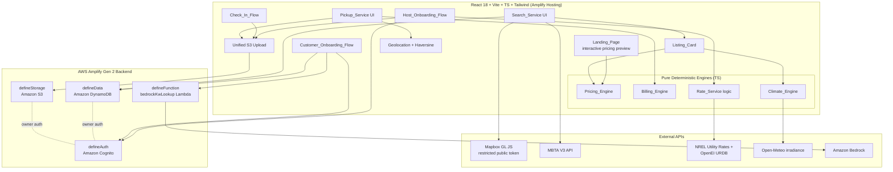

# Design Document

## Overview

VoltLot is a peer-to-peer "charge-and-ride" marketplace for Massachusetts EV drivers. Hosts list idle residential L1/L2 chargers and driveways; Customers book a time window, park, plug in without a key handoff, charge, and continue by MBTA transit or on foot. Because Hosts have no smart meters, the economic safety of the platform rests on a single guarantee: the hourly price is **deterministic and formula-driven**, mathematically bounded to always cover the maximum possible electricity draw of the specific car booked — both during the reservation and during any overstay.

This design realizes the five requirements through a thin, reactive React frontend over an AWS Amplify Gen 2 backend, with all money- and climate-affecting logic factored into **pure, deterministic TypeScript engines** (`Pricing_Engine`, `Billing_Engine`, `Climate_Engine`, `Rate_Service`). Keeping these engines free of I/O and framework state is a deliberate design decision: it makes the two PBT invariants in the requirements (Host Cost Upper-Bound, Green Score Bounds) directly unit- and property-testable, and it isolates external-API variability (NREL, Mapbox, MBTA, Open-Meteo, Bedrock) behind adapter boundaries.

Key design decisions and rationale:

- **Formula-only pricing; AI only for data lookup.** Amazon Bedrock is invoked *solely* to look up `car_max_AC_kW` for a vehicle absent from the EVSpec table (Requirement 1.9). It never influences a price. This keeps the Host Cost Upper-Bound Invariant (Property 1) provable, because pricing depends only on numeric inputs with known bounds.
- **Worst-case defaulting.** When `car_max_AC_kW` cannot be determined, the system defaults it to the Host's `charger_kW` (Requirement 1.10), forcing `P_eff = min(charger_kW, car_max_AC_kW) = charger_kW` — the maximum possible draw — so the Host never under-charges.
- **Pure engines, impure adapters.** Engines accept plain numeric inputs and return plain values or typed errors; adapters own timeouts, retries, and fallbacks (Requirements 1.6/1.7, 2.4, 4.2, 5.2/5.4).
- **Unified S3 upload flow.** Listing, Arrival, and Pickup photos share one upload component and one error/retry contract (Requirement 1.4, 5.2), differing only by S3 key.

## Architecture

The system is a single-page React 18 app served from Amplify Hosting, talking to an Amplify Gen 2 backend (Cognito auth, DynamoDB data, S3 storage, one Lambda function). External APIs are reached from the client where they are public/token-restricted (Mapbox, MBTA, Open-Meteo, NREL) and from a Lambda only where a secret or model access is required (Bedrock).



Request-flow notes:

- **Onboarding (Req 1):** Cognito Hosted/managed auth gates both role flows. On ZIP entry the `Rate_Service` calls NREL (5s budget) and falls back to $0.30/kWh. Driveway photo goes through the unified S3 upload (30s budget, retry on failure).
- **Search (Req 2):** The client reads active listings from DynamoDB, filters by client-side Haversine against the search radius, then enriches with Mapbox walk times and MBTA transit (each 10s budget, partial-render on failure). `Listing_Card` renders per-car price (`Pricing_Engine`) and Green Score (`Climate_Engine`).
- **Pricing/Billing (Req 3):** Pure engines compute price at listing render and final settlement at Pickup tap.
- **Climate (Req 4):** `Climate_Engine` consumes Open-Meteo hourly irradiance (10s budget) and computes solar share and Green Score.
- **Check-in/Pickup (Req 5):** Arrival photo marks session ACTIVE; Pickup requires geolocation within 50m (30s acquisition budget) plus a confirmed pickup photo, or a photo-only flagged fallback when permission is denied.

## Components and Interfaces

### Frontend Components

All components are React 18 function components styled with Tailwind. They own presentation and orchestration only; they delegate all money/climate math to the pure engines and all I/O to adapters.

- **Landing_Page** — *supports Requirement 1.1.* Renders the value proposition, the two role CTAs ("Become a Host", "Find a Charger (Customer)"), and an interactive car-based pricing preview. On car selection change it calls `Pricing_Engine.computePrice` with representative listing defaults and displays the recalculated estimated price per hour synchronously (no network needed for the preview).
- **Host_Onboarding_Flow** — *supports Requirements 1.2–1.7.* Collects all Host inputs, performs per-field format validation, retains entered values on any rejection, and renders per-field error indicators. Caps `host_earnings_hr` at 2x the suggested local parking rate. Drives the unified S3 upload for the driveway photo and consumes `Rate_Service` for `local_rate` auto-population/override.
- **Customer_Onboarding_Flow** — *supports Requirements 1.8–1.10.* Prompts Make/Model/Year, resolves `car_max_AC_kW` from EVSpec, then Bedrock fallback or manual entry, and finally defaults to the Host `charger_kW` worst case when still unresolved.
- **Search_Service UI** — *supports Requirements 2.1, 2.4, 2.5.* Accepts destination + time window + radius (0.1–25 mi, default 2), orchestrates Haversine filter + Mapbox + MBTA, renders partial results on adapter failure, and shows empty-results state.
- **Listing_Card** — *supports Requirements 2.2, 2.3, 2.6, 2.7.* Displays whole-minute walk time, nearby MBTA routes, per-car price/hr, estimated miles added (framed as "estimated miles added", never "full charge"), solar share % (0–100), Green Score (0–1). Shows plug-mismatch indication and disables booking when adapters cannot bridge; shows the "Charger slower than your car's max acceptance rate" badge and orders slow chargers last under "Best Charger Fit".
- **Check_In_Flow** — *supports Requirements 5.1, 5.2.* Requires a confirmed Arrival photo upload before transitioning the booking to ACTIVE; retains check-in state and offers retry on upload failure/timeout.
- **Pickup_Service UI** — *supports Requirements 5.3–5.7.* Invokes geolocation with a 30s timeout, computes Haversine distance, enforces the 50m geofence, requires a confirmed Pickup photo, triggers `Billing_Engine` settlement, and handles the permission-denied photo-only flagged fallback.

### Shared Upload + Geolocation Utilities

- **Unified S3 Upload** — one component/hook used for Listing, Arrival, and Pickup photos (Requirements 1.4, 5.1, 5.2, 5.5, 5.7). Parameterized by target S3 key; enforces a 30s completion budget and returns a typed success/failure that callers turn into retry UI.
- **Geolocation + Haversine** — wraps `navigator.geolocation.getCurrentPosition` with a 30s timeout and exposes a pure `haversineMeters(a, b)` used both at Pickup and (in miles form) for client-side listing distance filtering.

### Logic Engines (pure, deterministic TypeScript)

These modules are framework-agnostic and I/O-free. They are the unit- and property-test surface. All numeric inputs are validated against the bounds in the requirements; invalid inputs yield a typed error result rather than a thrown exception, so callers and tests can assert on the failure discriminant.

Shared result type:

```typescript
type EngineError = { ok: false; invalidInput: string; message: string };
type Ok<T> = { ok: true; value: T };
type EngineResult<T> = Ok<T> | EngineError;
```

#### Pricing_Engine — *supports Requirements 3.1, 3.2, 3.3*

```typescript
interface PricingInput {
  charger_kW: number;        // > 0
  car_max_AC_kW: number | null; // null => worst-case default to charger_kW (Req 1.10)
  local_rate: number;        // $/kWh, > 0
  host_earnings_hr: number;  // >= 0
  booked_hours: number;      // > 0
}

interface PricingOutput {
  P_eff: number;                 // min(charger_kW, car_max_AC_kW)
  electricity_cost_per_hr: number; // P_eff * local_rate, 2dp round-half-up
  price_per_hr: number;          // electricity_cost_per_hr + host_earnings_hr, 2dp
  estimated_miles_added: number; // P_eff * booked_hours * 3.5, 1dp
}

// P_eff = min(charger_kW, car_max_AC_kW ?? charger_kW)
function computePrice(input: PricingInput): EngineResult<PricingOutput>;
```

Rounding is centralized in a `roundHalfUp(value, decimals)` helper so every monetary output (`price_per_hr`, `electricity_cost_per_hr`, `late_fee`, `customer_total`) uses identical semantics (Requirement 3.3).

#### Billing_Engine — *supports Requirements 3.3, 3.4, 3.5*

```typescript
interface BillingInput {
  price_per_hr: number;          // from Pricing_Engine snapshot
  booked_hours: number;
  booked_end_timestamp: number;  // epoch ms
  pickup_timestamp: number;      // epoch ms; early pickup allowed, no refund (Req 3.5)
}

interface BillingOutput {
  late_minutes: number;          // max(0, pickup - booked_end) in minutes
  late_fee: number;              // (late_minutes/60) * (price_per_hr * 1.5), 2dp
  customer_total: number;        // ((price_per_hr*booked_hours)+late_fee)*1.10, 2dp
}

function settle(input: BillingInput): EngineResult<BillingOutput>;
```

Early pickup produces `late_minutes = 0` and no refund for unused booked hours (Requirement 3.5). The 10% platform fee multiplier (1.10) is applied last.

#### Climate_Engine — *supports Requirements 4.1, 4.3, 4.4, 4.5*

```typescript
interface SolarShareInput {
  system_kW: number;         // >= 0
  P_eff: number;             // > 0
  booked_hours: number;      // > 0
  irradiance_W_m2: number[]; // hourly I_h from Open-Meteo; length must >= booked_hours (Req 4.2)
}

interface GreenScoreInput {
  solar_share: number;           // [0,1]
  P_eff: number;
  booked_hours: number;
  estimated_miles_added: number; // >= 0
  transit_miles: number;         // >= 0
}

// solar_kW(h)        = system_kW * (I_h / 1000) * 0.8
// usable_solar_kW(h) = min(max(solar_kW(h) - 1.0, 0), P_eff)   // 1 kW house baseline
// solar_share        = sum(usable_solar_kW(h)) / (P_eff * booked_hours), in [0,1]
function computeSolarShare(input: SolarShareInput): EngineResult<number>;

// grid_kWh        = P_eff * booked_hours * (1 - solar_share)
// gas_co2_saved_kg= (estimated_miles_added * 0.40) - (grid_kWh * 0.33)
// G = 0.50*solar_share + 0.25*min(transit_miles/20,1) + 0.25*min(max(gas_co2_saved_kg,0)/5,1)
// G rounded to 3dp, clamped to [0,1]
function computeGreenScore(input: GreenScoreInput): EngineResult<number>;
```

The overnight case (every `usable_solar_kW(h) = 0`) yields `solar_share` with absolute value < 0.001; the engine returns the computed value without substituting a larger one (Requirement 4.4). Both `solar_share` and `G` are clamped into `[0,1]` as the final step, which is what Property 2 asserts must always hold.

#### Rate_Service — *supports Requirements 1.6, 1.7*

The deterministic selection logic (which rate to use, how to apply TOU) is a pure function; the network call and timeout are in an adapter.

```typescript
interface RateResolution {
  local_rate: number;        // $/kWh
  source: "NREL" | "OpenEI_TOU" | "DEFAULT_0_30";
  overridable: true;
}

// Pure: decide the effective rate given whatever the adapter returned (or null on timeout).
function resolveRate(nrelRate: number | null, touRate: number | null): RateResolution;
// Default path returns { local_rate: 0.30, source: "DEFAULT_0_30" } (Req 1.7).
```

## Data Models

Data is defined with Amplify Gen 2 `defineData` (`amplify/data/resource.ts`). Authorization is owner-based: a Host owns their listings; a Customer owns their bookings and profile. EVSpec is a seeded reference table readable by any authenticated user.

```typescript
// amplify/data/resource.ts (shape)
import { a, defineData, type ClientSchema } from "@aws-amplify/backend";

const schema = a.schema({
  UserProfile: a
    .model({
      role: a.enum(["HOST", "CUSTOMER"]),
      displayName: a.string(),
      // Customer vehicle snapshot
      ev_make: a.string(),
      ev_model: a.string(),
      ev_year: a.integer(),
      car_max_AC_kW: a.float(), // resolved value or worst-case default (Req 1.10)
    })
    .authorization((allow) => [allow.owner()]),

  HostListing: a
    .model({
      address: a.string().required(),
      zip: a.string().required(),           // 5-digit MA ZIP
      lat: a.float().required(),
      lng: a.float().required(),
      charger_kW: a.float().required(),
      charger_level: a.enum(["L1", "L2"]),
      plug_type: a.enum(["J1772", "NACS"]),
      adapters_available: a.enum(["J1772_TO_NACS", "NACS_TO_J1772", "BOTH", "NONE"]),
      solar_kW: a.float().required(),
      num_spots: a.integer().required(),
      host_earnings_hr: a.float().required(), // capped at 2x suggested parking rate (Req 1.5)
      local_rate: a.float().required(),        // NREL or $0.30 default (Req 1.6/1.7)
      availability_daytime: a.string(),        // serialized window(s)
      availability_overnight: a.string(),
      listing_photo_key: a.string(),           // S3 key, unified upload (Req 1.4)
      active: a.boolean().required(),          // search filters active==true (Req 2.1)
    })
    .authorization((allow) => [allow.owner(), allow.authenticated().to(["read"])]),

  EVSpec: a
    .model({
      make: a.string().required(),
      model: a.string().required(),
      year: a.integer().required(),
      max_ac_kw: a.float().required(), // seeded from Open EV Data (Req 1.8)
    })
    .authorization((allow) => [allow.authenticated().to(["read"])]),

  Booking: a
    .model({
      listingId: a.id().required(),
      customerId: a.id().required(),
      booked_start: a.datetime().required(),
      booked_end: a.datetime().required(),
      // immutable snapshots taken at booking time (keep settlement deterministic)
      car_max_AC_kW_snapshot: a.float().required(),
      P_eff_snapshot: a.float().required(),
      price_per_hr_snapshot: a.float().required(),
      status: a.enum(["RESERVED", "ACTIVE", "COMPLETED"]),
      actual_end_time: a.datetime(),
      late_fee: a.float(),
      customer_total: a.float(),
      geofence_status: a.enum(["OK", "FLAGGED_FOR_HOST_REVIEW"]), // Req 5.7
      arrival_photo_key: a.string(), // media/bookings/{bookingId}/arrival.jpg
      pickup_photo_key: a.string(),  // media/bookings/{bookingId}/pickup.jpg
      solar_share: a.float(),
      green_score: a.float(),
    })
    .authorization((allow) => [allow.owner()]),
}).authorization((allow) => [allow.resource]);

export type Schema = ClientSchema<typeof schema>;
export const data = defineData({ schema });
```

Design notes:

- **Snapshots for determinism (Req 3).** `car_max_AC_kW_snapshot`, `P_eff_snapshot`, and `price_per_hr_snapshot` are frozen on the Booking at reservation time so late-fee/settlement math at Pickup cannot drift if reference data changes. This directly supports the Host Cost Upper-Bound Invariant (Property 1) using the booked snapshot.
- **S3 key convention (Req 5.1, 5.5, 5.7).** Photos live at `media/bookings/{bookingId}/arrival.jpg` and `media/bookings/{bookingId}/pickup.jpg`. The listing photo uses `media/listings/{listingId}/listing.jpg`. All three flow through one unified upload utility; only the key differs.
- **Storage authorization.** `defineStorage` grants owners write to their own `media/...` prefixes and grants read of listing photos to authenticated users, mirroring the data authorization.
- **EVSpec as reference data.** Read-only to authenticated users; seeded from Open EV Data with a US-model fallback table.

## External Integrations

Each integration is wrapped in an adapter that owns its timeout and fallback, keeping the engines pure. Timeout budgets follow the requirements exactly.

- **Mapbox GL JS (restricted public token)** — *Requirement 2.1, 2.4.* Client-side walking time and distance to the destination; token is domain-restricted. Also renders the map. **10s** budget; on failure/timeout the Search_Service shows an error for the walk-time field but still renders the remaining listings. Client-side **Haversine** distance filtering over DynamoDB listings runs locally first so results exist even if Mapbox is degraded.
- **MBTA V3 API** — *Requirement 2.1, 2.4.* Nearby T stations, commuter rail, bus stops, routes, and schedules within the search radius. **10s** budget; partial-render on failure (transit section shows an error, listings still render).
- **NREL Utility Rates API + $0.30 fallback + OpenEI URDB** — *Requirement 1.6, 1.7.* On 5-digit MA ZIP entry, the `Rate_Service` adapter queries NREL residential average $/kWh with a **5s** budget and auto-populates `local_rate` (Host may override). On unavailability/timeout it defaults to **$0.30/kWh**. OpenEI URDB provides Time-of-Use rate schedules for the flex path; `resolveRate` chooses the effective value deterministically.
- **Open-Meteo hourly irradiance** — *Requirement 4.1, 4.2.* Free, no API key; returns hourly irradiance `I_h` (W/m^2) across the booking window. **10s** budget. If the fetch fails, times out, or returns fewer hourly values than `booked_hours`, the `Climate_Engine` aborts, leaves any stored score unchanged, and returns a "solar data unavailable" error.
- **Amazon Bedrock via `defineFunction`** — *Requirement 1.9.* A single Lambda (`bedrockKwLookup`) invoked only when an EVSpec Make/Model/Year lookup misses. It returns a candidate `car_max_AC_kW`; if it too fails, the flow falls back to manual entry, then to the worst-case `charger_kW` default (Req 1.10). Bedrock output never enters any pricing formula.
- **Browser Geolocation API** — *Requirement 5.3, 5.4, 5.6, 5.7.* `navigator.geolocation.getCurrentPosition` with a **30s** acquisition timeout; distance computed via Haversine against listing coordinates. The **S3** uploads (listing/arrival/pickup) also use a **30s** completion budget (Req 1.4, 5.2).

Timeout budget summary: NREL **5s**; Mapbox / MBTA / Open-Meteo **10s**; S3 uploads and geolocation acquisition **30s**.

## Correctness Properties

*A property is a characteristic or behavior that should hold true across all valid executions of a system — essentially, a formal statement about what the system should do. Properties serve as the bridge between human-readable specifications and machine-verifiable correctness guarantees.*

The prework analysis classified most acceptance criteria as either formula properties (Requirements 3 and 4), error-condition edge cases (3.2, 4.3), geometric/decision properties (2.1, 2.6, 2.7, 5.3/5.5/5.6), or integration/example checks (external APIs, UI presence). After the property reflection, the deterministic pricing/billing formulas and their rounding consolidate into a single Host-cost guarantee, and the solar/Green-Score formulas (including the overnight boundary) consolidate into a single bounds guarantee. These are exactly the two PBT invariants mandated by `requirements.md`, restated below with their input domains. They are the properties implemented with fast-check in the Testing Strategy.

### Property 1: Host Cost Upper-Bound Invariant

*For all* `charger_kW` in [1.44, 19.2], `car_max_AC_kW` in [3.0, 22.0] ∪ {null}, `local_rate` in [0.10, 0.65], `host_earnings_hr` >= 0, `booked_hours` in [0.5, 24], and `late_minutes` in [0, 720], the Host Payout `(price_per_hr * booked_hours) + late_fee` SHALL be greater than or equal to the maximum possible physical electricity cost `charger_kW * (booked_hours + late_minutes / 60) * local_rate`, where `price_per_hr` and `late_fee` are produced by the `Pricing_Engine` and `Billing_Engine`, and where `car_max_AC_kW = null` is resolved to `charger_kW` (worst case `P_eff = charger_kW`).

**Validates: Requirements 3.1, 3.3, 3.4, 3.5, 1.10**

### Property 2: Green Score Bounds Invariant

*For all* `system_kW` in [0, 25], hourly `irradiance` values in [0, 1300], `transit_miles` in [0, 100], and `booked_hours` > 0 (with `P_eff` > 0), both `solar_share` (from `Climate_Engine.computeSolarShare`) and the Green Score `G` (from `Climate_Engine.computeGreenScore`) SHALL evaluate to finite numbers within the closed interval [0.0, 1.0]. This includes the overnight boundary where every `usable_solar_kW(h) = 0`, for which `solar_share` is returned with absolute value < 0.001 rather than substituted with a larger value.

**Validates: Requirements 4.1, 4.4, 4.5**

## Error Handling

Error handling maps the IF/THEN acceptance criteria to concrete strategies. The unifying pattern: **engines validate inputs and return typed errors; adapters own timeouts, retries, and fallbacks; UI components retain prior state and surface per-field or per-section indications.**

### Input Validation (reject + identify + preserve)

- **Pricing input validation (Req 3.2).** `Pricing_Engine.computePrice` checks every input against its bounds (`charger_kW > 0`, `local_rate > 0`, `host_earnings_hr >= 0`, `booked_hours > 0`, `car_max_AC_kW` numeric or null). Any missing/non-numeric/out-of-bounds value returns `EngineError` naming the field; no `price_per_hr` is produced.
- **Climate input validation (Req 4.3).** `Climate_Engine` rejects missing/negative/non-numeric `system_kW`, `P_eff`, `booked_hours`, `estimated_miles_added`, or `transit_miles`, returning an error identifying the field, with no Green Score.
- **Host onboarding validation (Req 1.3).** On any missing/invalid field the `Host_Onboarding_Flow` blocks submission, keeps all entered values in form state, and renders a per-field error. `host_earnings_hr` is clamped to 2x the suggested local parking rate (Req 1.5).

### Upload Retries (S3, 30s budget)

- **Driveway / Arrival / Pickup photos (Req 1.4, 5.2, 5.5, 5.7).** The unified upload utility enforces a 30s completion budget. On failure or timeout it returns a typed failure; the calling flow retains state (onboarding values, check-in state, pickup state), does **not** advance the session (no ACTIVE, no settlement), and renders a retry affordance. Pickup settlement requires a *confirmed* upload before `actual_end_time` is recorded.

### API Timeout Fallbacks

- **NREL rate (Req 1.6, 1.7).** 5s budget. On success, auto-populate `local_rate` (overridable). On unavailability/timeout, `resolveRate(null, …)` defaults to **$0.30/kWh** (`source: DEFAULT_0_30`), still overridable.
- **Mapbox / MBTA (Req 2.4).** 10s budget each. On failure/timeout, show an error indication for the affected data (walk time or transit routes) and still render the remaining listing results from the local Haversine filter.
- **Open-Meteo (Req 4.2).** 10s budget. On failure, timeout, or fewer hourly values than `booked_hours`, `Climate_Engine` aborts, leaves any previously stored score unchanged, and returns a "solar data unavailable" error.
- **Bedrock fallback (Req 1.9, 1.10).** On EVSpec miss, invoke `bedrockKwLookup`; on its failure, accept manual kW entry; if still unresolved, default `car_max_AC_kW` to the Host `charger_kW` worst case. Bedrock output never enters a pricing formula.

### Geofence Block / Flag (Req 5.4, 5.6, 5.7)

- **Acquisition timeout (Req 5.4).** Geolocation 30s timeout → block session termination, show retry.
- **Outside geofence (Req 5.6).** Haversine distance > 50m → block termination, display the current distance rounded to the nearest whole meter.
- **Permission denied (Req 5.7).** Allow a photo-only fallback pickup that still requires a confirmed `pickup.jpg` upload, and set `geofence_status = FLAGGED_FOR_HOST_REVIEW`.

### Empty / Mismatch States

- **No results (Req 2.5).** Empty-results indication when no active listing matches destination/time/radius.
- **Plug mismatch (Req 2.6).** Visible plug-mismatch indication and disabled booking when neither the native plug matches nor an owned Host adapter bridges the conversion.

## Testing Strategy

The strategy is dual: **unit/example tests** pin down exact formula values, rounding boundaries, error-path behavior, and UI/integration wiring; **property-based tests** verify the two mandated universal invariants across their full input domains. Adapters (NREL, Mapbox, MBTA, Open-Meteo, Bedrock, S3, geolocation) are mocked so engine logic is tested in isolation from I/O.

### Unit and Example Tests

- **Pricing_Engine:** exact `P_eff`, `electricity_cost_per_hr`, `price_per_hr`, `estimated_miles_added`; round-half-up at the `.005` boundary (Req 3.1, 3.3); invalid-input rejection naming the field (Req 3.2); `car_max_AC_kW = null` → `P_eff = charger_kW` (Req 1.10).
- **Billing_Engine:** `late_minutes = max(0, …)`, prorated `late_fee` with zero grace, `customer_total` with the 1.10 fee; early pickup → `late_minutes = 0`, no refund (Req 3.4, 3.5).
- **Climate_Engine:** `solar_kW(h)`, `usable_solar_kW(h)` clamp at the 1 kW baseline and at `P_eff`, `grid_kWh`, `gas_co2_saved_kg`, `G` at 3dp; overnight all-zero series → `|solar_share| < 0.001` (Req 4.1, 4.4, 4.5); invalid-input rejection (Req 4.3); Open-Meteo abort/keep-stored-score on short/failed series (Req 4.2, mocked).
- **Rate_Service:** `resolveRate(null, null)` → $0.30 `DEFAULT_0_30`; NREL success path populates and stays overridable (Req 1.6, 1.7).
- **Haversine / geofence:** symmetry, non-negativity, zero-at-equal, and known reference distances; 50m decision and whole-meter display (Req 5.3, 5.5, 5.6).
- **Compatibility / sort:** plug+adapter bookable predicate (Req 2.6); "Best Charger Fit" ordering places `charger_kW >= car_max_AC_kW` before slower listings and shows the slow badge (Req 2.7).
- **UI / integration (mocked adapters):** Landing_Page CTAs + live pricing preview (Req 1.1); Listing_Card fields and "estimated miles added" framing (Req 2.2, 2.3); partial render on Mapbox/MBTA failure (Req 2.4); empty results (Req 2.5); Arrival-photo gate to ACTIVE and upload retry (Req 5.1, 5.2); geolocation timeout/denied fallback with flagged status (Req 5.4, 5.7).

### Property-Based Testing (fast-check)

Property tests use **fast-check** (the standard PBT library for TypeScript). We do **not** implement PBT infrastructure from scratch. Each property runs a **minimum of 100 iterations** (`fc.assert(..., { numRuns: 100 })`) and is implemented as a **single** property test tagged with a comment referencing the design property:

- Tag format: `// Feature: voltlot-mvp, Property 1: Host Cost Upper-Bound Invariant`
- Tag format: `// Feature: voltlot-mvp, Property 2: Green Score Bounds Invariant`

#### Arbitraries / Generators

**Property 1 — Host Cost Upper-Bound Invariant** (domain from `requirements.md`):

- `charger_kW`: `fc.double({ min: 1.44, max: 19.2, noNaN: true })`
- `car_max_AC_kW`: `fc.oneof(fc.double({ min: 3.0, max: 22.0, noNaN: true }), fc.constant(null))` — the `null` arbitrary exercises the Req 1.10 worst-case default.
- `local_rate`: `fc.double({ min: 0.10, max: 0.65, noNaN: true })`
- `host_earnings_hr`: `fc.double({ min: 0, max: 1000, noNaN: true })` (domain `>= 0`; bounded above for generator practicality — only raises payout, never weakens the invariant)
- `booked_hours`: `fc.double({ min: 0.5, max: 24, noNaN: true })`
- `late_minutes`: `fc.integer({ min: 0, max: 720 })`

Assertion: resolve `car_max_AC_kW ?? charger_kW`, run `Pricing_Engine.computePrice` then `Billing_Engine.settle` with a `pickup_timestamp = booked_end_timestamp + late_minutes*60000`, and assert `(price_per_hr * booked_hours) + late_fee >= charger_kW * (booked_hours + late_minutes/60) * local_rate`. The worst case `P_eff = charger_kW` is the binding case; whenever `car_max_AC_kW < charger_kW` the physical draw is strictly lower, so the inequality holds with margin.

**Property 2 — Green Score Bounds Invariant** (domain from `requirements.md`):

- `system_kW`: `fc.double({ min: 0, max: 25, noNaN: true })`
- `irradiance` series: `fc.array(fc.double({ min: 0, max: 1300, noNaN: true }), { minLength: 1, maxLength: 24 })`; `booked_hours` is derived from (or paired to be <=) the series length so `computeSolarShare` has enough hourly values.
- `transit_miles`: `fc.double({ min: 0, max: 100, noNaN: true })`
- `P_eff`: `fc.double({ min: 0.0001, max: 22, noNaN: true })` (strictly `> 0`)
- `booked_hours`: `fc.double({ min: 0.0001, max: 24, noNaN: true })` (strictly `> 0`)

Assertion: compute `solar_share` and `G`; assert both are finite (`Number.isFinite`) and `0 <= value <= 1`. Include the overnight boundary by letting the generator produce all-zero irradiance arrays, where `|solar_share| < 0.001` must still fall within `[0,1]`.

Both property tests reference the invariants in the Correctness Properties section above; unit tests cover the exact numeric and error-path behavior that properties do not pin to specific values.
